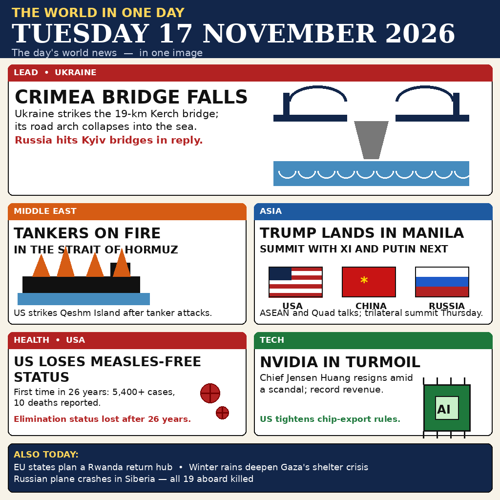

# Tuesday 17 November 2026 — the world's news in one image

[](https://make.fun/bounty/news-image-20261117?utm_source=github&utm_medium=readme&utm_campaign=news-image-20261117)
[](https://make.fun/bounty/news-image-20261117/leaderboard?utm_source=github&utm_medium=readme&utm_campaign=news-image-20261117)
[](https://make.fun/bounty/news-image-20261117?utm_source=github&utm_medium=readme&utm_campaign=news-image-20261117)



A make.fun entry for **news-image-20261117**: "Sum up 17 November's world
news in one image" — see the bounty at
[make.fun/bounty/news-image-20261117](https://make.fun/bounty/news-image-20261117).

## What it shows

A newspaper front page for **Tuesday 17 November 2026**, drawn
programmatically (see `draw.py`, Pillow + DejaVu) from reporting of that
day, cross-checked in Reuters and BBC:

- **Lead — Ukraine:** Ukraine strikes the 19-km Kerch / Crimea Bridge;
  its road arch collapses into the Kerch Strait. Russia hits Kyiv
  bridges in reply.
- **Middle East:** Tankers on fire in the Strait of Hormuz; the US
  strikes a missile site on Qeshm Island after tanker attacks.
- **Asia:** Trump lands in Manila for ASEAN / Quad talks, ahead of a
  trilateral summit with Xi Jinping and Vladimir Putin.
- **Health — USA:** The US loses measles elimination status for the
  first time in 26 years: 5,400+ cases, 10 deaths.
- **Tech:** Nvidia in turmoil — chief Jensen Huang resigns amid a
  scandal; record revenue reported; the US tightens chip-export rules.
- **Also today:** five EU states plan a Rwanda return hub for rejected
  asylum seekers; winter rains deepen Gaza's shelter crisis; a Russian
  military plane crashes in Siberia, killing all 19 aboard.

## How it runs

`main.ts` (Node 22, standard library only) copies `entry.png` to
`/output/entry.png`. No network, deterministic — both runs write the
same bytes.

```sh
mkdir -p out && MAKEFUN_OUTPUT_DIR=out node main.ts
```

`entry.png` is 1024×1024, about 101 KB, well under the 1 MiB limit.

## License

MIT — see `LICENSE`.
